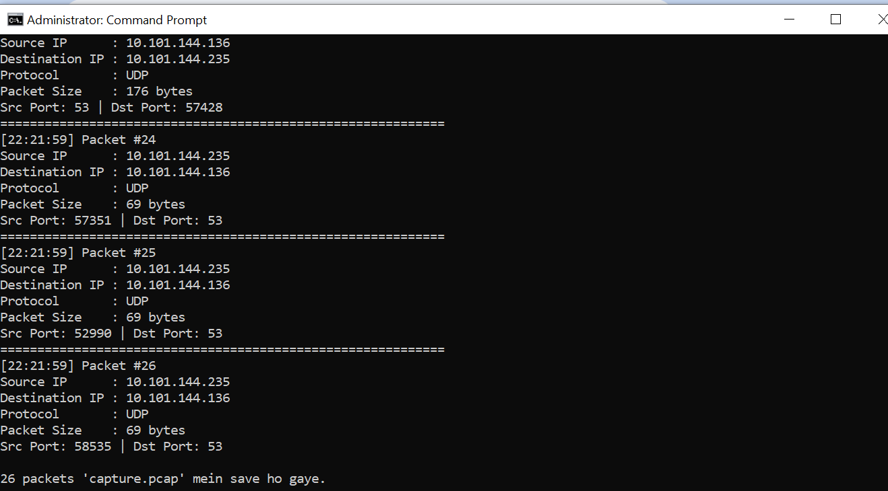

# CodeAlpha_BasicNetworkSniffer

A basic network sniffer built with Python and Scapy as part of my
Cyber Security Internship at CodeAlpha.

## Features
- Captures live network packets
- Shows source and destination IP addresses
- Identifies protocols (TCP, UDP, ICMP)
- Displays ports, TCP flags and packet size
- Shows payload preview (first 50 bytes)
- Saves captured packets to capture.pcap

## Requirements
- Python 3.x
- Scapy (`pip install scapy`)
- Npcap (Windows) or libpcap (Linux)

## How to Run
1. Open terminal as Administrator
2. Run: `python sniffer.py`
3. Press Ctrl+C to stop

## Sample Output

## Disclaimer
This tool is for educational purposes only. Use it only on networks you own or have permission to test.